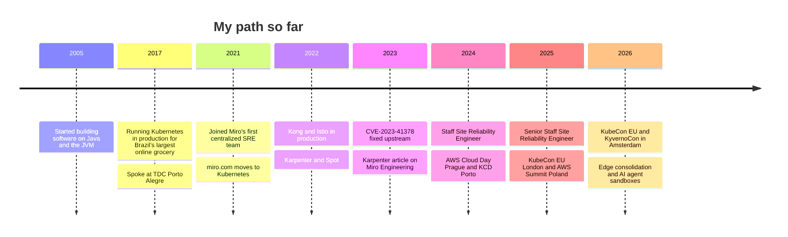

<h1 align="center">Hi, I'm Rodrigo 👋</h1>

  <b>Senior Staff Site Reliability Engineer at <a href="https://miro.com">Miro</a></b> 
  Platform engineering · Kubernetes · AWS · Haarlem, the Netherlands

  
  
  
  
  

I am a Software Engineer turned Site Reliability Engineer, with 21 years in the field. I started on Java and the JVM,
building platforms that need high throughput, low latency and reliability. Caring about how that software behaved in
production pulled me towards DevOps, and platform engineering has been my main focus ever since.

At Miro I am a technical leader for the Cloud Compute platform on AWS: EKS, EC2, autoscaling and scheduling. I like the
problems that sit between the platform and the application: a scheduler and an autoscaler that disagree, a health
check that stays green while traffic fails, a latency regression that turns out to be where an instance landed.

When I find a bug in a tool we depend on, I try to fix it upstream. 🛠️

---

## 🧭 What I'm working on

- ☸️ The compute platform behind Miro: EKS fleets, Karpenter, Graviton and Spot, all in infrastructure code
- 🌐 A simpler edge for Miro: one Envoy-based gateway, tested against a production-shaped replica first
- 📦 Compute for AI agent sandboxes: Kata microVMs, fast starts with lazy image pulling, egress enforced on the node
- 🗣️ Sharing what we learn, on stage and upstream

## 🏆 Highlights at Miro

<b>Moving Miro onto Kubernetes</b>

- Led the technical validation that moved Miro's board and table servers, the core of the product, from EC2 onto
  Kubernetes, with load tests and a performance sign-off before each step
- Proved the Java monolith could run on Kubernetes and inside the service mesh, the groundwork for that move
- Root-caused a latency regression after the move to EC2 placement relative to the cache tier, and won back 14-25% of
  median latency
- Moved the miro.com website from EC2 web servers to Kubernetes behind a new edge router, path by path in five phases
- Co-led bringing the Kong API gateway and the Istio service mesh to production on EKS

<b>Platform engineering and infrastructure as code</b>

- Built the environment automation golden path: the first Miro environment created entirely from code, later adopted
  as the standard way to write infrastructure code
- Delivered the infrastructure for Miro's Australian data residency environments in under two months
- Led the GitLab to GitHub migration of the infrastructure and Kubernetes repositories, history included
- Created the Helm chart and release path Miro's microservices use to deploy to EKS
- Built a production-shaped replica of Miro's edge with a vcluster vending machine, to test gateway candidates before
  migrating anything

<b>Efficiency and cost</b>

- Introduced Karpenter with Spot, cutting a non-production cluster's daily compute bill by about two thirds
- Made Spot safe for single-replica workloads and pushed clusters to near-full allocation, with about 43% fewer nodes
  in one region
- Cut container registry costs by 85% with same-region image pulls and lifecycle policies that know what is deployed
- Brought AWS Graviton (arm64) to the platform, from benchmark to production node pools
- Featured in AWS's case study on how Miro runs on Amazon EKS:
  [Miro drives hypergrowth with Amazon EKS](https://aws.amazon.com/solutions/case-studies/miro-eks-case-study)

<b>Reliability and deep debugging</b>

- Proved the production EKS cluster could scale about 8x, and removed the bottlenecks found on the way
- Found and fixed a five-year-old Calico Typha bug behind a CI outage, credited in
  [CVE-2023-41378](https://www.tigera.io/security-bulletins-tta-2023-001)
- Rebuilt the board PDF and SVG export service around headless Chrome workers; large exports got about 7x faster
- Made a silent pod-network failure in the VPC CNI policy agent visible, with alerting and runbooks

## 🗓️ Timeline

<b>Roles at Miro</b>

| Since | Role | Team |
|---|---|---|
| 2025 | Senior Staff Site Reliability Engineer | Platform Engineering stream |
| Apr 2024 | Staff Site Reliability Engineer | Infrastructure |
| 2023 | Site Reliability Engineer | Compute |
| 2021 | Site Reliability Engineer | SRE Cloud |
| Feb 2021 | Site Reliability Engineer | Centralized SRE team |

## 🎤 Talks and writing

| When | Where | What | Links |
|---|---|---|---|
| Mar 2026 | KubeCon + CloudNativeCon Europe, Amsterdam | Cutting Metrics Traffic, Cutting Costs: The AZ-Aware Observability Blueprint | [🎥 video](https://www.youtube.com/watch?v=ycnDgULCHTA) · [💻 demo](https://github.com/rodrigorfk/kubecon-eu-2026-az-observability) · [📅 schedule](https://kccnceu2026.sched.com/event/2CW5m) |
| Mar 2026 | KyvernoCon Europe, Amsterdam | Kyverno Mutating Policies: Shifting Platform Logic Into the Control Plane | [💻 demo](https://github.com/rodrigorfk/kyvernocon-2026-shifting-platform-logic) · [📅 schedule](https://colocatedeventseu2026.sched.com/event/2DY8H) |
| Oct 2025 | Kubernetes Podcast (NL), episode 112 | Stateful on Kubernetes: Lessons from Miro's Real-Time Platform | [🎧 listen](https://www.k8spodcast.nl/afleveringen/aflevering-112-stateful-on-kubernetes-lessons-from-miros-real-time-platform) |
| May 2025 | AWS Summit Poland | Maximizing Kubernetes Efficiency with Karpenter: A Miro Case Study | |
| Apr 2025 | KubeCon + CloudNativeCon Europe, London | Stateful Connections in Kubernetes: The Scaling Secrets Nobody Talks About | [🎥 video](https://www.youtube.com/watch?v=h1AyaAIf3HA) · [📅 schedule](https://kccnceu2025.sched.com/event/1txHO) |
| Oct 2024 | AWS Cloud Day Prague | Maximizing Kubernetes Efficiency with Karpenter: A Miro Case Study | |
| Sep 2024 | KCD Porto | Kyverno mutating policies | [💻 demo](https://github.com/rodrigorfk/k8s-kyverno-mutating-policies) |
| Sep 2024 | Life at Miro / Medium | Automating Kubernetes Workflows with Kyverno's Mutating Webhooks | [📝 read](https://medium.com/@rodrigofk/automating-kubernetes-workflows-with-kyvernos-mutating-webhooks-ae3f0a81d4d7) |
| Sep 2023 | Miro Engineering | Optimizing Kubernetes scalability and cost-efficiency with Karpenter | [📝 read](https://medium.com/miro-engineering/optimizing-kubernetes-scalability-and-cost-efficiency-with-karpenter-356153fcf546) |
| Nov 2017 | TDC Porto Alegre | Kubernetes and immutable infrastructure with Ansible, Packer and AWS | [📅 track](https://thedevconf.com/tdc/2017/portoalegre/trilha-devops) |
| 2017 | Talk (pt-BR) | Kubernetes: Orchestrating Brazil's largest online grocery | [🖼️ slides](https://www.slideshare.net/slideshow/kubernetes-orquestrando-o-maior-ecommerce-alimentar-do-brasil/78599962) |

## 🌱 Open source

Fixes and features I got merged upstream while running these tools at scale:

| Project | What | PRs |
|---|---|---|
| [Calico](https://github.com/projectcalico/calico) | Timeout for the Typha TLS handshake, the fix behind CVE-2023-41378 | [#7909](https://github.com/projectcalico/calico/pull/7909) |
| [Karpenter](https://github.com/kubernetes-sigs/karpenter) | Consider pending pods with preferred node affinity | [#2182](https://github.com/kubernetes-sigs/karpenter/pull/2182) |
| [Argo CD](https://github.com/argoproj/argo-cd) | Faster short ref resolution in the repo-server for large monorepos | [#26456](https://github.com/argoproj/argo-cd/pull/26456) |
| [Kyverno](https://github.com/kyverno/kyverno) | Metrics controls, MutatingPolicy user info, and more | [6 merged](https://github.com/kyverno/kyverno/pulls?q=is%3Apr+author%3Arodrigorfk+is%3Amerged) |
| [Terragrunt](https://github.com/gruntwork-io/terragrunt) | Symlinked module discovery, `skip` merging, dependency outputs from state | [4 merged](https://github.com/gruntwork-io/terragrunt/pulls?q=is%3Apr+author%3Arodrigorfk+is%3Amerged) |
| [External Secrets](https://github.com/external-secrets/external-secrets) | Vault mTLS, PushSecret improvements | [3 merged](https://github.com/external-secrets/external-secrets/pulls?q=is%3Apr+author%3Arodrigorfk+is%3Amerged) |
| [cert-manager](https://github.com/cert-manager/cert-manager) | Secrets informer race fix, Vault mTLS | [2 merged](https://github.com/cert-manager/cert-manager/pulls?q=is%3Apr+author%3Arodrigorfk+is%3Amerged) |
| [Trivy Operator](https://github.com/aquasecurity/trivy-operator) | Private registry auth and image mirroring fixes | [2 merged](https://github.com/aquasecurity/trivy-operator/pulls?q=is%3Apr+author%3Arodrigorfk+is%3Amerged) |

More: KEDA, vcluster, helmfile, Grafana, podinfo and others

[KEDA](https://github.com/kedacore/keda/pulls?q=is%3Apr+author%3Arodrigorfk+is%3Amerged) ·
[vcluster](https://github.com/loft-sh/vcluster/pulls?q=is%3Apr+author%3Arodrigorfk+is%3Amerged) ·
[helmfile](https://github.com/helmfile/helmfile/pulls?q=is%3Apr+author%3Arodrigorfk+is%3Amerged) ·
[Grafana](https://github.com/grafana/grafana/pulls?q=is%3Apr+author%3Arodrigorfk+is%3Amerged) ·
[podinfo](https://github.com/stefanprodan/podinfo/pulls?q=is%3Apr+author%3Arodrigorfk+is%3Amerged) ·
[kms-issuer](https://github.com/Skyscanner/kms-issuer/pulls?q=is%3Apr+author%3Arodrigorfk+is%3Amerged) ·
[terraform-aws-msk-apache-kafka-cluster](https://github.com/cloudposse/terraform-aws-msk-apache-kafka-cluster/pulls?q=is%3Apr+author%3Arodrigorfk+is%3Amerged) ·
[pipeline-aws-plugin](https://github.com/jenkinsci/pipeline-aws-plugin/pulls?q=is%3Apr+author%3Arodrigorfk+is%3Amerged)

## 🧰 Tools I work with

  
  
  
  
  
  
  
  
  
  
  
  
  
  
  
  
  
  

---

Opinions here are my own. Happy to talk about platforms, Kubernetes and the bugs in between.

